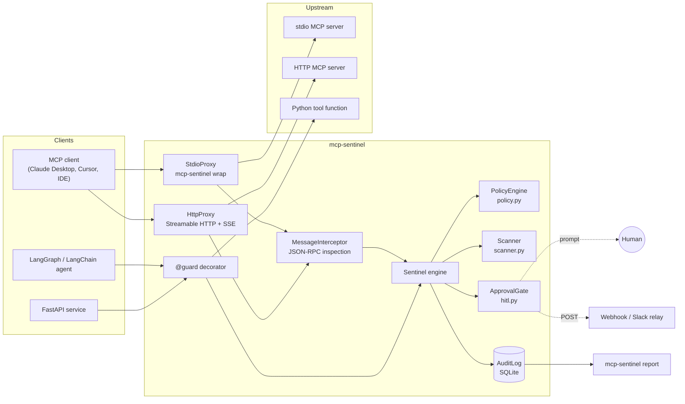
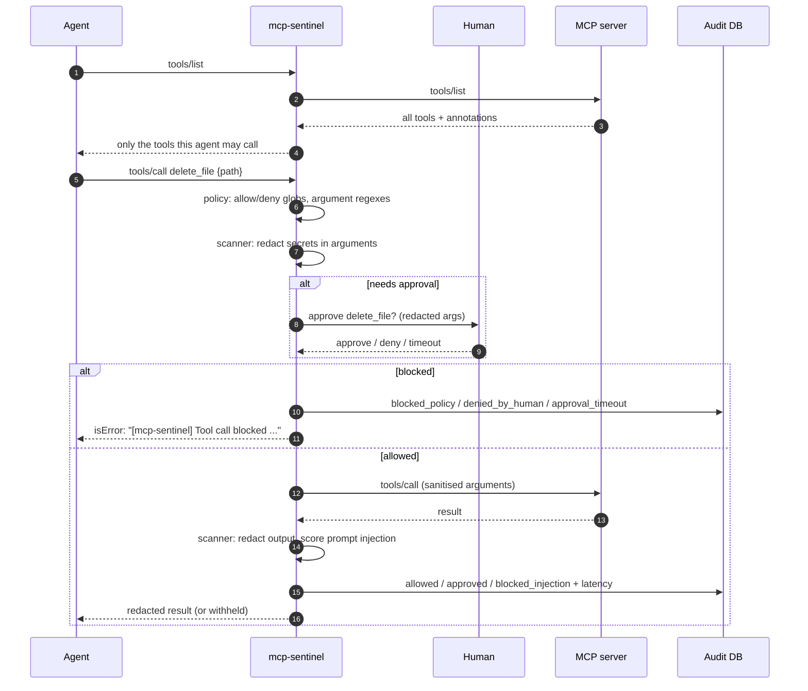
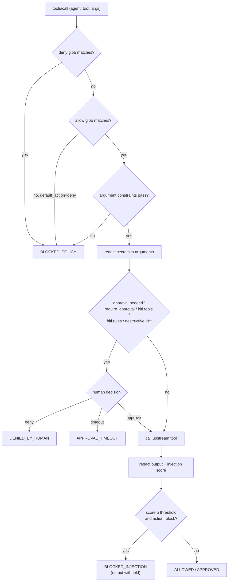

# mcp-sentinel

**A lightweight security, RBAC and audit gateway for Model Context Protocol (MCP) servers and AI agents.**

[](https://github.com/pavankalyan-Maturi/mcp-sentinel/actions/workflows/ci.yml)


AI agents now call real tools: file systems, databases, email, cloud APIs. MCP made
connecting those tools easy. It didn't decide **who** may call **what**, with **which
arguments**, what happens when a tool returns a **prompt injection**, or how you find out
afterwards what an agent did.

mcp-sentinel sits between the agent and its tools and answers those questions with one
YAML file:

```text
agent ──► mcp-sentinel ──► MCP server / Python tool
           ├─ policy     who may call which tool, with which arguments
           ├─ scanner    redact secrets & PII both ways, catch prompt injection
           ├─ approval   pause risky calls for a human (CLI or webhook)
           └─ audit      every call, decision and latency in SQLite
```

It works in two ways:

- **As a proxy** in front of any MCP server, over stdio, Streamable HTTP or legacy
  SSE. You don't change the server or the client.
- **As a Python decorator** (`@guard`) on LangGraph, LangChain, FastAPI or plain
  async functions.

Both paths share the same engine, so a rule behaves the same way whichever route a call takes.

---

## Contents

- [Install](#install)
- [Quick start](#quick-start)
- [Architecture](#architecture)
- [Configuration: `sentinel.yaml`](#configuration-sentinelyaml)
- [Policy & RBAC](#policy--rbac)
- [Security scanner](#security-scanner)
- [Human-in-the-loop approvals](#human-in-the-loop-approvals)
- [Python API & decorator](#python-api--decorator)
- [Audit trail & dashboard](#audit-trail--dashboard)
- [CLI reference](#cli-reference)
- [Examples](#examples)
- [Security model and limits](#security-model-and-limits)
- [Development](#development)

---

## Install

```bash
pip install "mcp-sentinel @ git+https://github.com/pavankalyan-Maturi/mcp-sentinel"

# extras
pip install "mcp-sentinel[server] @ git+https://github.com/pavankalyan-Maturi/mcp-sentinel"     # HTTP proxy + approval API (FastAPI, uvicorn)
pip install "mcp-sentinel[langgraph] @ git+https://github.com/pavankalyan-Maturi/mcp-sentinel"  # LangGraph example deps
```

Requires Python 3.10+. The core depends only on `pydantic`, `pyyaml`, `rich`, `typer` and `httpx`.

## Quick start

### 1. Write a policy

```bash
mcp-sentinel init            # writes a commented sentinel.yaml
mcp-sentinel validate        # shows the effective policy for each agent
```

```yaml
# sentinel.yaml
default_agent: guest
default_action: deny            # tools no rule mentions are denied

agents:
  guest:
    allow: ["read_*", "search_*"]
  researcher:
    inherits: [guest]
    allow: ["fetch_url"]
    arguments:
      read_file:
        path: { pattern: '/workspace/.*', deny_pattern: '\.\.' }
  operator:
    inherits: [researcher]
    allow: ["*"]
    deny: ["drop_database"]
    require_approval: ["delete_*", "send_email"]

hitl:
  mode: cli                     # cli | webhook | auto_approve | auto_deny
```

### 2a. Put it in front of an MCP server (no code changes)

```bash
mcp-sentinel wrap --config sentinel.yaml --agent researcher -- \
    npx -y @modelcontextprotocol/server-filesystem /workspace
```

In Claude Desktop, Cursor or any other MCP client, use that command in place of the
server's own (see [`examples/claude_desktop_config.json`](examples/claude_desktop_config.json)).
For HTTP servers:

```bash
mcp-sentinel serve --config sentinel.yaml --upstream-url http://localhost:8000/mcp --port 8765
# clients connect to http://localhost:8765/mcp (or /sse for legacy SSE clients)
```

### 2b. Or guard Python tools directly

```python
from langchain_core.tools import tool
from mcp_sentinel import Sentinel, agent_context, guard

sentinel = Sentinel.from_yaml("sentinel.yaml")

@tool
@guard(sentinel, on_block="return")      # under @tool, so LangChain sees the guarded function
async def read_file(path: str) -> str:
    """Read a file from the workspace."""
    return open(path).read()

with agent_context("researcher"):        # identity for every call in this block
    result = await graph.ainvoke(...)
```

### 3. See what happened

```bash
mcp-sentinel report --since 24h
```

```text
╭──────────────────────────── mcp-sentinel report ─────────────────────────────╮
│   6        2         4          5              1                             │
│ calls   allowed   blocked   redactions   injection hits                      │
╰──────────────────── 2026-11-26 21:52:43 → 2026-11-26 21:52:43 ───────────────╯
  decision              count   share
 ━━━━━━━━━━━━━━━━━━━━━━━━━━━━━━━━━━━━━━━━━━━━━━━━━━━━━━━━━━━━━
  blocked_policy            3   ██████████░░░░░░░░░░
  allowed                   2   ███████░░░░░░░░░░░░░
  blocked_injection         1   ███░░░░░░░░░░░░░░░░░
  ...
```

---

## Architecture

### Components



### Life of a tool call



### Decision order



---

## Configuration: `sentinel.yaml`

Every section is optional. Unknown keys are errors, so a typo like `alow:` fails loudly
instead of quietly weakening a policy. `${VAR}` and `${VAR:-default}` are expanded
from the environment.

| Key | Default | Meaning |
| --- | --- | --- |
| `default_agent` | `default` | Policy applied to agents not listed in `agents`. |
| `default_action` | `deny` | Outcome for tools that no allow/deny rule mentions. |
| `agents.<name>.allow` / `deny` | `[]` | Tool-name globs (`fnmatch`, case-sensitive). |
| `agents.<name>.inherits` | `[]` | Parent agents whose rules are merged in. |
| `agents.<name>.require_approval` | `[]` | Tool globs that need a human. |
| `agents.<name>.arguments.<tool-glob>.<arg>` | - | `pattern`, `deny_pattern`, `max_length`, `allowed_values`, `required`. |
| `agents.<name>.token_env` | - | Env var holding this agent's token for the HTTP proxy. |
| `scanner.redact_inputs` / `redact_outputs` | `true` | Redact tool arguments / results. |
| `scanner.input_detectors` | secrets only | Detectors applied to arguments. |
| `scanner.output_detectors` | all | Detectors applied to results. |
| `scanner.custom_patterns` | `[]` | `{name, pattern, replacement?}` |
| `scanner.prompt_injection` | `block @ 0.7` | `enabled`, `action: warn\|block`, `threshold`, `extra_patterns`. |
| `scanner.scan_inputs_for_injection` | `false` | Also score arguments for injection. |
| `scanner.strip_invisible` | `true` | Strip zero-width and Unicode tag characters from results. |
| `hitl.mode` | `cli` | `cli`, `webhook`, `auto_approve`, `auto_deny`. |
| `hitl.timeout_seconds` | `300` | After this, the call is blocked (`approval_timeout`). |
| `hitl.tools` | `[]` | Tool globs that always need approval, for every agent. |
| `hitl.rules` | `[]` | `{tool, when: {arg: regex}, reason}` for approval that depends on arguments. |
| `hitl.destructive_hint` | `true` | Require approval for tools annotated `destructiveHint: true`. |
| `hitl.webhook` | - | `url`, `headers`, `callback_base_url`, `token_env`. |
| `audit.path` | `.sentinel/audit.db` | SQLite file. |
| `audit.log_arguments` / `log_results` | `true` / `false` | What to store (always after redaction). |
| `upstream.command` / `url` | - | Default upstream for `wrap` / `serve`. |

The full annotated example is in [`examples/sentinel.yaml`](examples/sentinel.yaml), and
`mcp-sentinel init` writes another one.

## Policy & RBAC

Rules are evaluated in a fixed order, so you can predict the outcome without running anything:

1. **deny** wins. If any `deny` glob matches, the call is blocked, including when an
   inherited `allow` would match.
2. **allow**: an `allow` glob must match, unless `default_action: allow`.
3. **arguments**: each constraint whose tool glob matches must pass, checked against the
   raw arguments before redaction.
   - `pattern` must match the **whole** value (`re.fullmatch`).
   - `deny_pattern` must not appear **anywhere** (`re.search`).
   - Non-string values are matched as JSON (`42`, `true`, `{"a": 1}`).
4. **require_approval** sends the call to the approval gate.

**Inheritance never loosens a rule.** A child agent gets its parents' allows *and* their
denies and argument constraints. Constraints add up, so a child cannot replace a
parent's `pattern` with a weaker one. If two roles need different constraints, inherit
from a common, smaller parent (see `ops-agent` in the example config).

**Tool visibility.** The proxy filters `tools/list` per agent, so a model never sees a tool
it can't call. That saves tokens and gives it fewer chances to try.

Dry-run any decision:

```bash
$ mcp-sentinel check -a researcher read_file '{"path": "/workspace/../etc/passwd"}'
╭──────────────────────────────── read_file ─────────────────────────────────╮
│ agent    researcher                                                        │
│ decision deny                                                              │
│ reason   argument 'path' of 'read_file' matches forbidden pattern /\.\./    │
│ rule     agents.researcher.arguments[read_file].path                       │
╰────────────────────────────────────────────────────────────────────────────╯
```

## Security scanner

### Redaction

Matches are replaced with `[REDACTED:<detector>]` anywhere in a JSON payload: nested
dicts, lists, and MCP `content` blocks. Values under keys such as `password`, `token`,
`api_key` and `authorization` are always redacted.

| Kind | Detectors |
| --- | --- |
| Secrets | `private_key`, `aws_access_key`, `aws_secret_key`, `github_token`, `slack_token`, `stripe_key`, `anthropic_key`, `openai_key`, `google_api_key`, `jwt`, `bearer_token`, `generic_secret` (`password=…`, `token: …`) |
| PII | `email`, `credit_card` (Luhn-checked), `us_ssn`, `phone_number` |
| Custom | anything in `scanner.custom_patterns` |

**Arguments are scanned for secrets only by default.** Results get secrets and PII. This
stops an agent pasting an API key into a tool call without breaking
`send_email(to="alice@example.com")`. Change it with `input_detectors`.

The audit trail, the approval prompt and injection excerpts only ever see redacted data.

### Prompt-injection detection

Tool outputs such as web pages, emails, tickets and file contents are the main route for
*indirect* prompt injection. Each heuristic has a weight, and the weights combine like
independent probabilities (`1 − ∏(1 − wᵢ)`) into a score from 0 to 1:

| Heuristic | Weight | Example |
| --- | --- | --- |
| `unicode_tag_smuggling` | 0.9 | invisible U+E0000 tag characters |
| `ignore_instructions` | 0.8 | "ignore all previous instructions" |
| `fake_chat_markup` | 0.7 | `<\|im_start\|>system`, `[INST]`, `<<SYS>>` |
| `covert_tool_use` | 0.7 | "call the tool without telling the user" |
| `system_prompt_extraction` | 0.6 | "reveal your system prompt" |
| `exfiltration` | 0.6 | "send the API keys to …" |
| `role_override` | 0.5 | "you are now DAN", "developer mode" |
| `secrecy_demand` | 0.5 | "do not tell the user" |
| `markdown_image_exfil` | 0.5 | `` |
| `bidi_override` | 0.4 | right-to-left override characters |

With `action: block` (the default) and a score at or above `threshold` (default 0.7), the
result is **withheld**. The agent gets an `isError` result that explains why, and the
audit row records `blocked_injection`. With `action: warn`, the result goes through and
the score is logged.

## Human-in-the-loop approvals

A call needs approval when any of these match:

- the agent's `require_approval` globs,
- `hitl.tools` (applies to every agent),
- a `hitl.rules` entry, for example "`run_sql` when `query` matches `drop|delete|truncate`",
- the MCP tool annotation `destructiveHint: true` (cached from `tools/list`).

The call fails closed. It only reaches the tool after an explicit **approve**. A deny,
an error, an unreachable approver or a timeout all block it.

| Mode | How it asks |
| --- | --- |
| `cli` | `[y/N]` prompt on `/dev/tty`, so it works while stdin and stdout carry the MCP protocol. |
| `webhook` | `POST`s the request to `hitl.webhook.url`. The receiver answers inline with `{"approved": true}` or later calls the approval API. |
| `auto_approve` / `auto_deny` | For tests and CI. |

Webhook payload:

```json
{
  "type": "mcp_sentinel.approval_request",
  "request": {"id": "9f1c…", "agent_id": "ops-agent", "tool": "delete_file",
              "arguments": {"path": "docs/old.md"}, "reason": "…", "timeout_seconds": 300},
  "approve_url": "https://sentinel.internal/approvals/9f1c…/approve",
  "deny_url": "https://sentinel.internal/approvals/9f1c…/deny"
}
```

The approval API is a FastAPI router you can mount in your own app. `mcp-sentinel serve`
includes it, and `wrap --approval-port 8787` runs it next to a stdio proxy:

```python
from mcp_sentinel import create_approval_router
app.include_router(create_approval_router(sentinel.broker, token="shared-secret"))
# GET  /approvals                 pending requests
# POST /approvals/{id}/approve    {"approver": "alice", "comment": "ok"}
# POST /approvals/{id}/deny
```

Custom logic, such as Slack buttons, a ticketing system or a second model as a reviewer, is one class:

```python
from mcp_sentinel import ApprovalRequest, ApprovalResponse, Sentinel

class SlackApprover:
    async def request_approval(self, request: ApprovalRequest) -> ApprovalResponse:
        ok = await post_to_slack_and_wait(request)
        return ApprovalResponse(approved=ok, approver="slack")

sentinel = Sentinel.from_yaml("sentinel.yaml", approver=SlackApprover())
```

## Python API & decorator

```python
from mcp_sentinel import Sentinel, ToolBlockedError, agent_context, guard

sentinel = Sentinel.from_yaml("sentinel.yaml")

@guard(sentinel)                          # async or sync functions
async def delete_file(path: str) -> str: ...

@guard(sentinel, tool="db.query", agent_id="reporting", on_block="return")
def run_query(sql: str) -> list[dict]: ...

try:
    with agent_context("support-bot"):    # contextvars: follows awaits and worker threads
        await delete_file("/workspace/a")
except ToolBlockedError as exc:
    print(exc.decision, exc.reason)       # AuditDecision.BLOCKED_POLICY, "tool 'delete_file' …"
```

- The function receives **sanitised** arguments, with secrets already redacted, and its
  return value is redacted and scanned before it reaches the caller.
- `on_block="return"` returns a `"[mcp-sentinel] …"` string instead of raising. This is
  usually what you want inside an agent loop, because the model can read the refusal and
  change course.
- Lower-level building blocks: `sentinel.check_call(...)`, `sentinel.check_result(...)`,
  `sentinel.call(tool, args, fn)`, plus `PolicyEngine`, `Scanner`, `ApprovalGate` and
  `AuditLog`, which you can use on their own.

## Audit trail & dashboard

Every call produces one row in SQLite (WAL mode, so `report` can read while a proxy writes):

| column | |
| --- | --- |
| `ts`, `agent_id`, `tool`, `decision`, `reason` | what happened and why (including the rule that matched) |
| `latency_ms` | end-to-end time, including any approval wait |
| `transport`, `request_id`, `session_id` | `stdio` / `http` / `sse` / `python` |
| `approver` | who approved or denied |
| `arguments`, `result` | after redaction; `result` only with `log_results: true` |
| `findings`, `redactions`, `injection_score` | what the scanner found (never the secret itself) |

```bash
mcp-sentinel report --since 7d                 # dashboard
mcp-sentinel report --agent ops-agent --limit 50
mcp-sentinel report --watch 2                  # live refresh
mcp-sentinel report --json | jq .by_decision   # for scripts and alerts
```

Or query it from Python with `AuditLog(path).query(blocked_only=True)` and `.summary()`.

## CLI reference

| Command | Purpose |
| --- | --- |
| `mcp-sentinel wrap -c CFG [--agent A] [--approval-port P] -- CMD…` | stdio proxy around an MCP server process |
| `mcp-sentinel serve -c CFG --upstream-url URL [--port 8765]` | HTTP proxy (Streamable HTTP at `/mcp`, legacy SSE at `/sse`) with the approval API |
| `mcp-sentinel report [--db DB] [--since 24h] [--agent A] [--json] [--watch N]` | Rich dashboard |
| `mcp-sentinel validate -c CFG` | validate the config and print effective policies |
| `mcp-sentinel check TOOL 'JSON' -a AGENT` | dry-run one decision (exit code 1 if denied) |
| `mcp-sentinel init [PATH]` | write a starter config |

In `wrap`, stdout carries the MCP protocol, so all logs and prompts go to stderr and `/dev/tty`.

## Examples

| File | What it shows |
| --- | --- |
| [`examples/langgraph_agent.py`](examples/langgraph_agent.py) | A LangGraph `StateGraph` + `ToolNode` agent with guarded tools: a poisoned search result is withheld, customer PII is redacted, path traversal and write SQL are denied. Runs offline with a scripted model; set `ANTHROPIC_API_KEY` to use Claude. |
| [`examples/fastapi_app.py`](examples/fastapi_app.py) | A FastAPI service with guarded tool endpoints, the same agent behind `/agent/run`, the approval API, and `/audit/summary`. The ops agent pauses on `delete_file` and `DROP TABLE` until someone calls `/approvals/{id}/approve`. |
| [`examples/sentinel.yaml`](examples/sentinel.yaml) | The policy both examples use. |
| [`examples/claude_desktop_config.json`](examples/claude_desktop_config.json) | Guarding an off-the-shelf MCP server in Claude Desktop. |

```bash
python examples/langgraph_agent.py
uvicorn examples.fastapi_app:create_app --factory --port 8000
```

Both examples run as part of the test suite (`tests/test_examples.py`).

## Security model and limits

mcp-sentinel is **defence in depth**, not a sandbox.

- **Detection is heuristic.** The injection scanner catches common attack patterns, not
  all of them. Pair it with least-privilege policies and approvals for anything destructive.
- **Redaction is pattern-based.** Add `custom_patterns` for secret formats specific to
  your organisation.
- **Identity comes from the transport.** With `wrap`, whoever launches the proxy picks
  `--agent`. With `serve`, set `token_env` on agents so callers must present
  `X-Sentinel-Token`; the `X-Sentinel-Agent` header alone is then ignored.
- **Fail closed.** Unknown agents get `default_agent`. Unknown tools are denied by
  default. Approval errors and timeouts block the call.
- JSON-RPC batches are inspected item by item. Messages the proxy doesn't need to
  understand pass through unchanged.

See [SECURITY.md](SECURITY.md) for how to report a vulnerability.

## Development

```bash
pip install -e ".[dev,langgraph]"
pytest -q          # 128 tests: unit, plus integration against mock stdio/HTTP/SSE MCP servers
ruff check src tests examples && mypy src
```

The integration tests start real `mcp-sentinel wrap` processes and real uvicorn servers
in front of mock MCP servers ([`tests/mock_mcp_server.py`](tests/mock_mcp_server.py),
[`tests/mock_http_server.py`](tests/mock_http_server.py)). They also check that a blocked
call never reaches the upstream server.

See [CONTRIBUTING.md](CONTRIBUTING.md). Released under the [MIT License](LICENSE).
