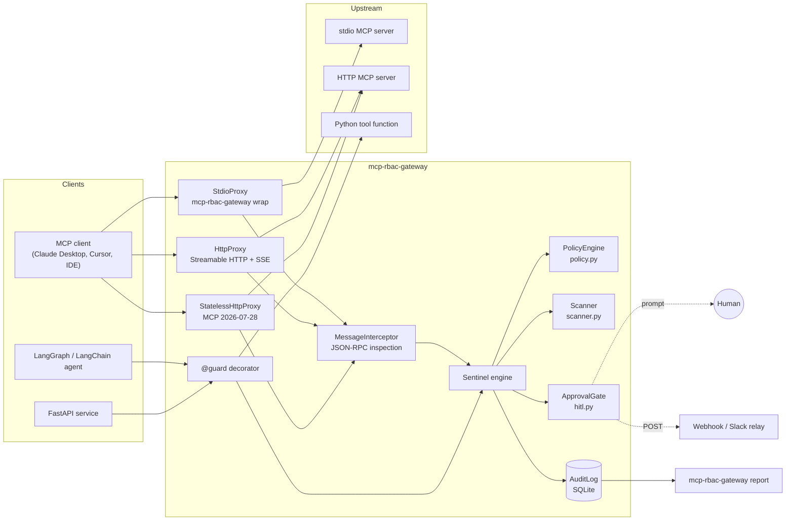
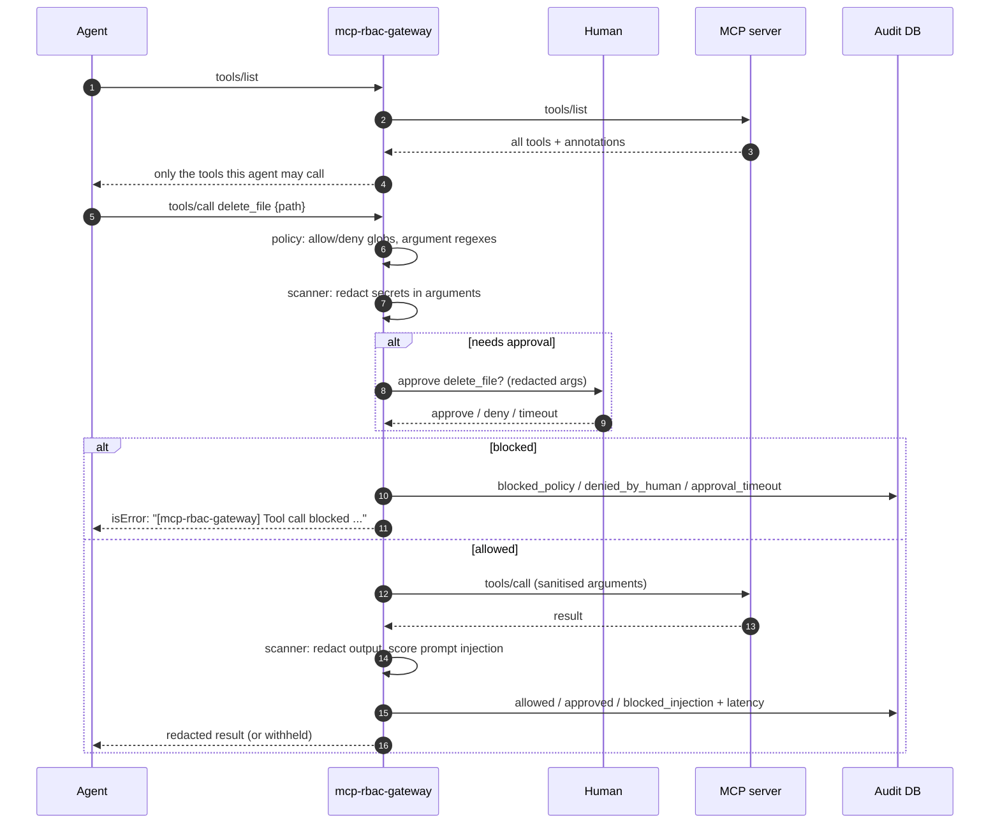
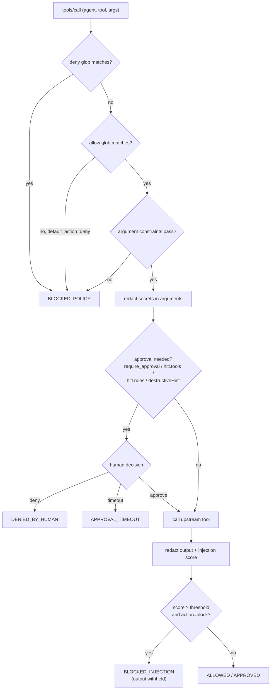

# mcp-rbac-gateway

**A lightweight security, RBAC and audit gateway for Model Context Protocol (MCP) servers and AI agents.**

[](https://github.com/pavankalyan-Maturi/mcp-rbac-gateway/actions/workflows/ci.yml)
[](https://pypi.org/project/mcp-rbac-gateway/)


AI agents now call real tools: file systems, databases, email, cloud APIs. MCP made
connecting those tools easy. It didn't decide **who** may call **what**, with **which
arguments**, what happens when a tool returns a **prompt injection**, or how you find out
afterwards what an agent did.

mcp-rbac-gateway sits between the agent and its tools and answers those questions with one
YAML file:

```text
agent ──► mcp-rbac-gateway ──► MCP server / Python tool
           ├─ policy     who may call which tool, with which arguments
           ├─ scanner    redact secrets & PII both ways, catch prompt injection
           ├─ approval   pause risky calls for a human (CLI, webhook or your own API)
           └─ audit      every call, decision and latency in SQLite
```

It works in two ways:

- **As a proxy** in front of any MCP server, over stdio, Streamable HTTP (including
  the stateless [2026-07-28 revision](#stateless-mcp-2026-07-28)) or legacy SSE. You
  don't change the server or the client.
- **As a Python decorator** (`@guard`) on LangGraph, LangChain, FastAPI or plain
  async functions.

Both paths share the same engine, so a rule behaves the same way whichever route a call takes.

---

## Contents

- [Install](#install)
- [Quick start](#quick-start)
- [Architecture](#architecture)
- [Configuration: `sentinel.yaml`](#configuration-sentinelyaml)
- [Policy & RBAC](#policy--rbac)
- [Security scanner](#security-scanner)
- [Human-in-the-loop approvals](#human-in-the-loop-approvals)
- [Stateless MCP (2026-07-28)](#stateless-mcp-2026-07-28)
- [Python API & decorator](#python-api--decorator)
- [Multi-tenant hosts](#multi-tenant-hosts)
- [Performance](#performance)
- [Audit trail & dashboard](#audit-trail--dashboard)
- [CLI reference](#cli-reference)
- [Examples](#examples)
- [Security model and limits](#security-model-and-limits)
- [Development](#development)

---

## Install

```bash
pip install mcp-rbac-gateway

# extras
pip install "mcp-rbac-gateway[server]"      # HTTP proxy + approval API (FastAPI, uvicorn)
pip install "mcp-rbac-gateway[langgraph]"   # LangGraph example deps
```


Requires Python 3.10+. The core depends only on `pydantic`, `pyyaml`, `rich`, `typer` and `httpx`.

## Quick start

### 1. Write a policy

```bash
mcp-rbac-gateway init            # writes a commented sentinel.yaml
mcp-rbac-gateway validate        # shows the effective policy for each agent
```

```yaml
# sentinel.yaml
default_agent: guest
default_action: deny            # tools no rule mentions are denied

agents:
  guest:
    allow: ["read_*", "search_*"]
  researcher:
    inherits: [guest]
    allow: ["fetch_url"]
    arguments:
      read_file:
        path: { pattern: '/workspace/.*', deny_pattern: '\.\.' }
  operator:
    inherits: [researcher]
    allow: ["*"]
    deny: ["drop_database"]
    require_approval: ["delete_*", "send_email"]

hitl:
  mode: cli                     # cli | webhook | auto_approve | auto_deny
```

### 2a. Put it in front of an MCP server (no code changes)

```bash
mcp-rbac-gateway wrap --config sentinel.yaml --agent researcher -- \
    npx -y @modelcontextprotocol/server-filesystem /workspace
```

In Claude Desktop, Cursor or any other MCP client, use that command in place of the
server's own (see [`examples/claude_desktop_config.json`](https://github.com/pavankalyan-Maturi/mcp-rbac-gateway/blob/main/examples/claude_desktop_config.json)).
For HTTP servers:

```bash
mcp-rbac-gateway serve --config sentinel.yaml --upstream-url http://localhost:8000/mcp --port 8765
# clients connect to http://localhost:8765/mcp (or /sse for legacy SSE clients)

# MCP 2026-07-28 (stateless: no initialize, no Mcp-Session-Id)
mcp-rbac-gateway proxy-http --config sentinel.yaml --upstream-url http://localhost:8000/mcp
```

### 2b. Or guard Python tools directly

```python
from langchain_core.tools import tool
from mcp_rbac_gateway import Sentinel, agent_context, guard

sentinel = Sentinel.from_yaml("sentinel.yaml")

@tool
@guard(sentinel, on_block="return")      # under @tool, so LangChain sees the guarded function
async def read_file(path: str) -> str:
    """Read a file from the workspace."""
    return open(path).read()

with agent_context("researcher"):        # identity for every call in this block
    result = await graph.ainvoke(...)
```

### 3. See what happened

```bash
mcp-rbac-gateway report --since 24h
```

```text
╭────────────────────────── mcp-rbac-gateway report ───────────────────────────╮
│   6        2         4          5              1                             │
│ calls   allowed   blocked   redactions   injection hits                      │
╰──────────────────── 2026-11-26 21:52:43 → 2026-11-26 21:52:43 ───────────────╯
  decision              count   share
 ━━━━━━━━━━━━━━━━━━━━━━━━━━━━━━━━━━━━━━━━━━━━━━━━━━━━━━━━━━━━━
  blocked_policy            3   ██████████░░░░░░░░░░
  allowed                   2   ███████░░░░░░░░░░░░░
  blocked_injection         1   ███░░░░░░░░░░░░░░░░░
  ...
```

---

## Architecture

### Components



### Life of a tool call



### Decision order



---

## Configuration: `sentinel.yaml`

Every section is optional. Unknown keys are errors, so a typo like `alow:` fails loudly
instead of quietly weakening a policy. `${VAR}` and `${VAR:-default}` are expanded
from the environment.

| Key | Default | Meaning |
| --- | --- | --- |
| `default_agent` | `default` | Policy applied to agents not listed in `agents`. |
| `default_action` | `deny` | Outcome for tools that no allow/deny rule mentions. |
| `agents.<name>.allow` / `deny` | `[]` | Tool-name globs (`fnmatch`, case-sensitive). |
| `agents.<name>.inherits` | `[]` | Parent agents whose rules are merged in. |
| `agents.<name>.require_approval` | `[]` | Tool globs that need a human. |
| `agents.<name>.arguments.<tool-glob>.<arg>` | - | `pattern`, `deny_pattern`, `max_length`, `allowed_values`, `required`. |
| `agents.<name>.methods.allow` / `deny` | `[]` | Globs of JSON-RPC methods other than `tools/call` (`tasks/*`, `skills/get`, `prompts/get` ...). Deny wins. With no `allow` list, unmentioned methods are allowed. |
| `agents.<name>.skills.allow` / `deny` | `[]` | Globs of skill paths (`skill://<path>/SKILL.md`). Unmentioned skills follow `default_action`. |
| `agents.<name>.token_env` | - | Env var holding this agent's token for the HTTP proxy. |
| `scanner.redact_inputs` / `redact_outputs` | `true` | Redact tool arguments / results. |
| `scanner.input_detectors` | secrets only | Detectors applied to arguments. |
| `scanner.output_detectors` | all | Detectors applied to results. |
| `scanner.custom_patterns` | `[]` | `{name, pattern, replacement?}` |
| `scanner.prompt_injection` | `block @ 0.7` | `enabled`, `action: warn\|block`, `threshold`, `extra_patterns`. |
| `scanner.scan_inputs_for_injection` | `false` | Also score arguments for injection. |
| `scanner.strip_invisible` | `true` | Strip zero-width and Unicode tag characters from results. |
| `hitl.mode` | `cli` | `cli`, `webhook`, `api`, `auto_approve`, `auto_deny`. See [which mode](#which-mode-when-you-mount-the-router). |
| `hitl.store` | `memory` | Where pending approvals live: `memory` (this process) or `sqlite` (survives restarts, shared by every process using the file). |
| `hitl.store_path` | `audit.path` | SQLite file for `store: sqlite`. |
| `hitl.timeout_seconds` | `300` | After this, the call is blocked (`approval_timeout`). |
| `hitl.tools` | `[]` | Tool globs that always need approval, for every agent. |
| `hitl.rules` | `[]` | `{tool, when: {arg: regex}, reason}` for approval that depends on arguments. |
| `hitl.destructive_hint` | `true` | Require approval for tools annotated `destructiveHint: true`. |
| `hitl.webhook` | - | `url`, `headers`, `callback_base_url`, `token_env`. |
| `audit.path` | `.sentinel/audit.db` | SQLite file. |
| `audit.log_arguments` / `log_results` | `true` / `false` | What to store (always after redaction). |
| `audit.writer` | `sync` | `sync`: one committed transaction per row. `batched`: a bounded queue and a background writer; see [Performance](#performance). |
| `audit.batch_size` / `flush_interval_ms` / `queue_size` | `100` / `50` / `10000` | Batched writer tuning. A full queue blocks the caller; rows are never dropped. |
| `tasks.bind_to_agent` | `true` | Only the agent whose `tools/call` created a task may get, update or cancel it. |
| `tasks.ttl_seconds` | `3600` | How long the gateway remembers which agent owns a task. |
| `upstream.command` / `url` | - | Default upstream for `wrap` / `serve` / `proxy-http`. |

The full annotated example is in [`examples/sentinel.yaml`](https://github.com/pavankalyan-Maturi/mcp-rbac-gateway/blob/main/examples/sentinel.yaml), and
`mcp-rbac-gateway init` writes another one.

## Policy & RBAC

Rules are evaluated in a fixed order, so you can predict the outcome without running anything:

1. **deny** wins. If any `deny` glob matches, the call is blocked, including when an
   inherited `allow` would match.
2. **allow**: an `allow` glob must match, unless `default_action: allow`.
3. **arguments**: each constraint whose tool glob matches must pass, checked against the
   raw arguments before redaction.
   - `pattern` must match the **whole** value (`re.fullmatch`).
   - `deny_pattern` must not appear **anywhere** (`re.search`).
   - Non-string values are matched as JSON (`42`, `true`, `{"a": 1}`).
4. **require_approval** sends the call to the approval gate.

**Inheritance never loosens a rule.** A child agent gets its parents' allows *and* their
denies and argument constraints. Constraints add up, so a child cannot replace a
parent's `pattern` with a weaker one. If two roles need different constraints, inherit
from a common, smaller parent (see `ops-agent` in the example config).

**Deny wins along the whole chain.** If a parent denies `X`, no child can allow `X`, not
even with an exact `allow: ["X"]` or `allow: ["*"]`. To give one role a tool its parent
denies, move the deny out of the shared parent into the roles that need it.

```yaml
# roles.yaml
default_agent: base
agents:
  base:
    allow: ["read_*", "search"]
    deny: ["read_secrets"]
  writer:
    inherits: [base]
    allow: ["write_file", "read_secrets"]
    require_approval: ["write_file"]
  admin:
    inherits: [writer]
    allow: ["*"]
    deny: ["drop_*"]
```

```text
$ mcp-rbac-gateway check-policy roles.yaml -t read_secrets -t write_file -t drop_table
effective policy: roles.yaml
╭────────────────┬───────────────┬────────────────────────────┬──────────────────────┬────────────┬──────────────┬────────────┬────────────╮
│ agent          │ inherits      │ allow                      │ deny                 │ approval   │ read_secrets │ write_file │ drop_table │
├────────────────┼───────────────┼────────────────────────────┼──────────────────────┼────────────┼──────────────┼────────────┼────────────┤
│ base (default) │ -             │ read_*, search             │ read_secrets         │ -          │     deny     │    deny    │    deny    │
│ writer         │ base          │ write_file, read_secrets,  │ read_secrets         │ write_file │     deny     │  approval  │    deny    │
│                │               │ read_*, search             │                      │            │              │            │            │
│ admin          │ writer > base │ *, write_file,             │ drop_*, read_secrets │ write_file │     deny     │  approval  │    deny    │
│                │               │ read_secrets, read_*,      │                      │            │              │            │            │
│                │               │ search                     │                      │            │              │            │            │
╰────────────────┴───────────────┴────────────────────────────┴──────────────────────┴────────────┴──────────────┴────────────┴────────────╯
default_action=deny (tools no rule matches)  deny wins over allow along the inheritance chain
```

The same answers from Python, for building the tool list you give the model and for
deciding whether to pause before a call:

```python
sentinel.visible_tools("writer", ["read_file", "read_secrets", "shell"])  # ["read_file"]
sentinel.needs_approval("writer", "write_file", {"path": "a"})  # "tool 'write_file' requires human approval ..."
sentinel.needs_approval("base", "write_file", {"path": "a"})    # None: it would be denied anyway
```

**Tool visibility.** The proxy filters `tools/list` per agent, so a model never sees a tool
it can't call. That saves tokens and gives it fewer chances to try.

Dry-run any decision:

```bash
$ mcp-rbac-gateway check -a researcher read_file '{"path": "/workspace/../etc/passwd"}'
╭──────────────────────────────── read_file ─────────────────────────────────╮
│ agent    researcher                                                        │
│ decision deny                                                              │
│ reason   argument 'path' of 'read_file' matches forbidden pattern /\.\./    │
│ rule     agents.researcher.arguments[read_file].path                       │
╰────────────────────────────────────────────────────────────────────────────╯
```

## Security scanner

### Redaction

Matches are replaced with `[REDACTED:<detector>]` anywhere in a JSON payload: nested
dicts, lists, and MCP `content` blocks. Values under keys such as `password`, `token`,
`api_key` and `authorization` are always redacted.

| Kind | Detectors |
| --- | --- |
| Secrets | `private_key`, `aws_access_key`, `aws_secret_key`, `github_token`, `slack_token`, `stripe_key`, `anthropic_key`, `openai_key`, `google_api_key`, `jwt`, `bearer_token`, `generic_secret` (`password=…`, `token: …`) |
| PII | `email`, `credit_card` (Luhn-checked), `us_ssn`, `phone_number` |
| Custom | anything in `scanner.custom_patterns` |

**Arguments are scanned for secrets only by default.** Results get secrets and PII. This
stops an agent pasting an API key into a tool call without breaking
`send_email(to="alice@example.com")`. Change it with `input_detectors`.

The audit trail, the approval prompt and injection excerpts only ever see redacted data.

### Prompt-injection detection

Tool outputs such as web pages, emails, tickets and file contents are the main route for
*indirect* prompt injection. Each heuristic has a weight, and the weights combine like
independent probabilities (`1 − ∏(1 − wᵢ)`) into a score from 0 to 1:

| Heuristic | Weight | Example |
| --- | --- | --- |
| `unicode_tag_smuggling` | 0.9 | invisible U+E0000 tag characters |
| `ignore_instructions` | 0.8 | "ignore all previous instructions" |
| `fake_chat_markup` | 0.7 | `<\|im_start\|>system`, `[INST]`, `<<SYS>>` |
| `covert_tool_use` | 0.7 | "call the tool without telling the user" |
| `system_prompt_extraction` | 0.6 | "reveal your system prompt" |
| `exfiltration` | 0.6 | "send the API keys to …" |
| `role_override` | 0.5 | "you are now DAN", "developer mode" |
| `secrecy_demand` | 0.5 | "do not tell the user" |
| `markdown_image_exfil` | 0.5 | `` |
| `bidi_override` | 0.4 | right-to-left override characters |

With `action: block` (the default) and a score at or above `threshold` (default 0.7), the
result is **withheld**. The agent gets an `isError` result that explains why, and the
audit row records `blocked_injection`. With `action: warn`, the result goes through and
the score is logged.

## Human-in-the-loop approvals

A call needs approval when any of these match:

- the agent's `require_approval` globs,
- `hitl.tools` (applies to every agent),
- a `hitl.rules` entry, for example "`run_sql` when `query` matches `drop|delete|truncate`",
- the MCP tool annotation `destructiveHint: true` (cached from `tools/list`).

The call fails closed. It only reaches the tool after an explicit **approve**. A deny,
an error, an unreachable approver or a timeout all block it.

| Mode | How it asks |
| --- | --- |
| `cli` | `[y/N]` prompt on `/dev/tty`, so it works while stdin and stdout carry the MCP protocol. |
| `webhook` | `POST`s the request to `hitl.webhook.url`. The receiver answers inline with `{"approved": true}` or later calls the approval API. |
| `api` | Waits for the approval API only (your own UI calls `POST /approvals/{id}/approve`). |
| `auto_approve` / `auto_deny` | For tests and CI. |

Webhook payload:

```json
{
  "type": "mcp_rbac_gateway.approval_request",
  "request": {"id": "9f1c…", "agent_id": "ops-agent", "tool": "delete_file",
              "arguments": {"path": "docs/old.md"}, "reason": "…", "timeout_seconds": 300},
  "approve_url": "https://sentinel.internal/approvals/9f1c…/approve",
  "deny_url": "https://sentinel.internal/approvals/9f1c…/deny"
}
```

The approval API is a FastAPI router you can mount in your own app. `mcp-rbac-gateway serve`
includes it. To run it next to a stdio proxy, pass `--approval-port`:

```bash
mcp-rbac-gateway wrap -c sentinel.yaml --approval-port 8787 -- python my_server.py
```

To mount it in your own FastAPI app:

```python
from mcp_rbac_gateway import create_approval_router
app.include_router(create_approval_router(sentinel.broker, token="shared-secret"))
# or reuse your own auth:  create_approval_router(sentinel.broker, dependencies=[Depends(current_user)])
# GET  /approvals                 pending requests
# POST /approvals/{id}/approve    {"approver": "alice", "comment": "ok"}   409 if already decided
# POST /approvals/{id}/deny
```

The router **fails closed**: with neither `token` nor `dependencies` it raises
`ValueError`, unless you pass `allow_unauthenticated=True`. `serve` and `proxy-http`
mount `/approvals` only with a token (`hitl.webhook.token_env`) or
`--allow-unauthenticated-approvals`, and refuse to start in `webhook`/`api` mode without
one, because calls would wait on an API anyone could answer.

#### Which mode when you mount the router

| `hitl.mode` | With the router mounted by your app |
| --- | --- |
| `api` | Calls wait for a decision on your router. Use this when people decide in your UI. |
| `webhook` | The same, plus a POST per request to `hitl.webhook.url` (Slack, paging). |
| `auto_deny` | Nothing waits on the router: approvals are denied at once and the queue stays empty. Use it to switch approvals off in an environment. |
| `cli` | Prompts on the server's terminal. Wrong for a server. |

With `check_call(..., wait=False)` the mode doesn't matter: the request goes to the
store and your code decides (see [Multi-tenant hosts](#multi-tenant-hosts)).

**Durable, multi-replica approvals.** `hitl.store: sqlite` keeps pending requests in a
table of the audit database (WAL mode). A restart loses nothing, any replica that shares
the file can list and decide a request, and a waiting call notices the decision by
polling the store with backoff. Decisions are atomic: of two concurrent approvals,
exactly one wins and the other gets `409`. For Postgres or Redis, implement the
five-method `ApprovalStore` protocol (`mcp_rbac_gateway.approvals`); a store may add a
`wait_for_change` hook (`LISTEN/NOTIFY`, pub/sub) so waiters don't poll. Requests carry
`tenant_id`, `session_id` and `request_id`, so `GET /approvals` can be scoped per tenant
(`require_scope=`) and an approval links to its audit rows.

Custom logic, such as Slack buttons, a ticketing system or a second model as a reviewer, is one class:

```python
from mcp_rbac_gateway import ApprovalRequest, ApprovalResponse, Sentinel

class SlackApprover:
    async def request_approval(self, request: ApprovalRequest) -> ApprovalResponse:
        ok = await post_to_slack_and_wait(request)
        return ApprovalResponse(approved=ok, approver="slack")

sentinel = Sentinel.from_yaml("sentinel.yaml", approver=SlackApprover())
```

## Stateless MCP (2026-07-28)

The [2026-07-28 revision](https://modelcontextprotocol.io/specification/2026-07-28/changelog)
of MCP removes the `initialize` handshake and `Mcp-Session-Id`. Every request carries its
protocol version and client info in `params._meta`, and Streamable HTTP requests carry
routing headers so that load balancers can route without parsing the body.
`mcp-rbac-gateway proxy-http` is a reverse proxy for that transport:

```bash
mcp-rbac-gateway proxy-http -c sentinel.yaml --upstream-url http://localhost:8000/mcp --port 8765
```

**Header checks.** Before anything is forwarded, the proxy checks the headers against the body
and answers `400` with a JSON-RPC error when they disagree. Policy is then decided on the
body. A router that trusts `Mcp-Name: echo` can't be used to slip a `delete_file` call past
the gateway.

| Header | Rule | Error |
| --- | --- | --- |
| `MCP-Protocol-Version` | required, a supported version, equal to `_meta["io.modelcontextprotocol/protocolVersion"]` | `-32022` / `-32020` |
| `Mcp-Method` | required, equal to the JSON-RPC `method` | `-32020` |
| `Mcp-Name` | required for `tools/call`, `prompts/get` (`params.name`), `resources/read` (`params.uri`) and `tasks/get\|update\|cancel` (`params.taskId`); `=?base64?…?=` values are decoded | `-32020` |
| `Mcp-Param-*` | forwarded. When redaction changes an argument that the tool's `inputSchema` mirrors with `x-mcp-header`, the header is rewritten to match | - |

The proxy also strips any `Mcp-Session-Id`, rejects JSON-RPC batches (send one message per
POST), and answers `GET` and `DELETE` with `405`. Keep using `serve` for 2025-era clients
and servers.

**`_meta` is preserved and audited.** Only `params.arguments` is ever rewritten (by redaction).
`_meta` reaches the server exactly as the client sent it, in every transport. The audit
trail stores `method`, `protocol_version`, `client_name`, `client_version`, `traceparent`,
`tracestate` and the full `_meta` (after redaction), so you can find a gateway decision from a
trace id:

```python
AuditLog(".sentinel/audit.db").query(trace_id="0af7651916cd43dd8448eb211c80319c")
```

`clientInfo` is self-reported, so it is recorded but never used for identity. Identity
still comes from `--agent`, `X-Sentinel-Agent` or `X-Sentinel-Token`.

**Tasks** ([`io.modelcontextprotocol/tasks`](https://modelcontextprotocol.io/extensions/tasks/overview)).
When a `tools/call` returns `resultType: "task"`, the gateway remembers which agent and tool
created it.
- `tasks/get`, `tasks/update` and `tasks/cancel` carry only a `taskId`, and they are refused
  (`-32602`, as for an unknown task) unless the same agent created it. This is
  `tasks.bind_to_agent`.
- Task results get the same redaction and injection check as tool results. A poisoned
  result is replaced with an error. Polls of a running task aren't audited one by one; the
  final state is, and its row is attributed to the original tool.
- `tasks/update` `inputResponses` are redacted before they reach the server.

The task map lives in memory. Behind several gateway replicas, route on `Mcp-Name` so that
polls reach the replica that saw the task, or set `bind_to_agent: false`.

**Skills** ([`io.modelcontextprotocol/skills`](https://modelcontextprotocol.io/extensions/skills/overview)).
`skills/list` is filtered per agent, like `tools/list`. `skills/get`, `resources/read` and
`resources/directory/read` on `skill://` URIs need a matching `skills` rule. Skill content
is scanned for prompt injection before the model sees it.

```yaml
agents:
  researcher:
    allow: ["search_*"]
    skills:
      allow: ["pdf-processing", "acme/*"]   # globs on skill://<path>/SKILL.md
      deny: ["acme/internal"]               # also covers every file under it
    methods:
      deny: ["tasks/cancel"]                # this agent may poll tasks but not cancel them
```

## Python API & decorator

```python
from mcp_rbac_gateway import Sentinel, ToolBlockedError, agent_context, guard

sentinel = Sentinel.from_yaml("sentinel.yaml")

@guard(sentinel)                          # async or sync functions
async def delete_file(path: str) -> str: ...

@guard(sentinel, tool="db.query", agent_id="reporting", on_block="return")
def run_query(sql: str) -> list[dict]: ...

try:
    with agent_context("support-bot"):    # contextvars: follows awaits and worker threads
        await delete_file("/workspace/a")
except ToolBlockedError as exc:
    print(exc.decision, exc.reason)       # AuditDecision.BLOCKED_POLICY, "tool 'delete_file' …"
```

- The function receives **sanitised** arguments, with secrets already redacted, and its
  return value is redacted and scanned before it reaches the caller.
- `on_block="result"` returns a `ToolDenial` instead of raising: `tool`, `decision`,
  `reason`, `retryable`, `hint`, `request_id`, `approval_id`. `denial.to_text()` is safe
  to put in a prompt: it never echoes the blocked arguments, withheld output or an
  exception message, and it tells the model whether to retry (`retryable` is true only for
  `approval_timeout` and tool errors). This is usually what you want inside an agent loop.
- `on_block="return"` (0.2 behaviour) returns a `"[mcp-rbac-gateway] …"` string.
- **Sync code.** `@guard` works on plain `def` functions, and `sentinel.call_sync(...)` /
  `check_call_sync(...)` / `resume_call_sync(...)` are blocking forms. With no running
  event loop they use `asyncio.run`. Inside a running loop (a sync tool called by
  LangGraph, for example) they never call `asyncio.run`: the async part runs on a worker
  thread with your context variables, and your function still runs in the calling thread.
  Don't call them from a coroutine on the loop itself; that blocks the loop. Use the async
  forms there.
- **Request context.** `call()`, `@guard` and `check_call()` take `context=CallContext(...)`,
  or read it from `with call_context(...)`. See [Multi-tenant hosts](#multi-tenant-hosts).
- Lower-level building blocks: `sentinel.check_call(...)`, `sentinel.check_result(...)`,
  `sentinel.record(...)`, `sentinel.call(tool, args, fn)`, `sentinel.visible_tools(...)`,
  `sentinel.needs_approval(...)`, plus `PolicyEngine`, `Scanner`, `ApprovalGate` and
  `AuditLog`, which you can use on their own.

## Multi-tenant hosts

A host that serves many tenants needs every audit row and approval tagged with the
tenant and the model's tool-call id, an audit API that can't leak across tenants,
approvals that survive restarts and replicas, and a way to pause with its own durable
mechanism (LangGraph `interrupt`, a Temporal signal) instead of a waiting coroutine.
The full runnable version is [`examples/multi_tenant.py`](https://github.com/pavankalyan-Maturi/mcp-rbac-gateway/blob/main/examples/multi_tenant.py).

```yaml
# sentinel.yaml
agents:
  member: {allow: ["read_*", "search"]}
  admin:  {inherits: [member], allow: ["delete_*"], require_approval: ["delete_*"]}
hitl:
  mode: api            # decisions come from your app, not a terminal
  store: sqlite        # pending approvals live in the audit DB: restart- and replica-safe
  timeout_seconds: 3600
audit:
  path: /data/gateway.db
```

**1. Tag every call with its tenant.** Bind the context once around the agent run (or
per tool call). It is a context variable, so it follows `await` and worker threads and
never leaks between concurrent requests. Every row the call writes (allowed, blocked,
injection, error, approval) carries it, and `traceparent` is filled from the current
OpenTelemetry span when OpenTelemetry is installed.

```python
from mcp_rbac_gateway import CallContext, Sentinel, ToolDenial, call_context

gateway = Sentinel.from_yaml("sentinel.yaml")

with call_context(tenant_id=user.tenant, session_id=thread_id, request_id=tool_call.id,
                  labels={"plan": "pro"}):
    out = await gateway.call(tool_call.name, tool_call.args, run_tool,
                             agent_id=user.role, wait=False, on_block="result")
# or explicitly: gateway.call(..., context=CallContext(tenant_id=..., request_id=...))
```

**2. Pause your own way, resume later.** With `wait=False` a call that needs approval
returns at once (`decision == "pending_approval"`, with `approval_id`). The request is in
the store and on the audit trail. Pause, then finish with `resume_call`, which writes the
decision with the same tenant and request ids:

```python
from langgraph.types import interrupt

if isinstance(out, ToolDenial):
    if out.decision == "pending_approval":
        answer = interrupt({"approval_id": out.approval_id, "tool": out.tool})  # checkpointed
        out = await gateway.resume_call(out.approval_id, answer["approved"], run_tool)
    else:
        return out.to_text()          # tell the model; never echoes the blocked payload
```

A second decision on the same request raises `ApprovalConflict` (`409` on the router).
Deciding a request that has expired writes `approval_timeout`.

**3. A tenant-scoped audit API.** `create_audit_router` serves `GET /audit` with filters
(`agent`, `tool`, `decision`, `blocked_only`, `since`, `session_id`, `request_id`,
`tenant_id`, `trace_id`, `limit` ≤ 500) and keyset pagination (`before_id`, stable while
rows are written). When `require_scope` returns a tenant, it is forced into the query,
whatever the caller asks for:

```python
from fastapi import Depends
from mcp_rbac_gateway import create_approval_router, create_audit_router

def tenant_of(request) -> str:            # e.g. the tenant claim of the verified JWT
    return request.state.user.tenant

app.include_router(create_audit_router(gateway.audit, require_scope=tenant_of,
                                       dependencies=[Depends(current_user)]))
app.include_router(create_approval_router(gateway.broker, require_scope=tenant_of,
                                          dependencies=[Depends(current_user)]))
```

From Python: `gateway.audit.query(tenant_id="acme", request_id="call_1")` and
`gateway.audit.page(tenant_id="acme", limit=100, before_id=cursor)`. The `events` table is
a **public, versioned schema** (`PRAGMA user_version`, migrated forward on open, changed
only by adding columns), so your own SQL on it is supported too.

**4. The same through the HTTP proxy.** Give `HttpProxy`, `StatelessHttpProxy` or
`DualHttpProxy` a `context_resolver(headers, body) -> CallContext` (called once per
request; its result goes on every row the request writes) and an
`agent_resolver(headers) -> role` that replaces `X-Sentinel-Token` (for example a role
claim of the caller's OAuth token). Either may be async; raising `PermissionError`
answers `401`.

```python
def tenant_from_jwt(headers, body) -> CallContext:
    claims = verify_jwt(headers.get("authorization", ""))   # raises PermissionError if invalid
    return CallContext(tenant_id=claims["tenant"], session_id=claims.get("sid"))

def role_from_jwt(headers) -> str | None:
    return verify_jwt(headers.get("authorization", ""))["role"]

proxy = DualHttpProxy(gateway, "http://mcp-server:8000/mcp",
                      context_resolver=tenant_from_jwt, agent_resolver=role_from_jwt,
                      approval_dependencies=[Depends(current_user)])
app = proxy.build_app()
```

`DualHttpProxy` (CLI: `proxy-http --dual-era`) serves both protocol eras on one endpoint:
a POST whose `MCP-Protocol-Version` is 2026-07-28 takes the stateless path with its header
checks, and everything else (a 2025-era `initialize`, session requests, `GET`, `/sse`)
takes the `HttpProxy` path.

To test a proxy without sockets, pass `transport=httpx.ASGITransport(app=upstream_app)`:
the proxy then reaches your in-process ASGI MCP server through it.

## Performance

Measured with [`benchmarks/overhead.py`](https://github.com/pavankalyan-Maturi/mcp-rbac-gateway/blob/main/benchmarks/overhead.py)
(`python benchmarks/overhead.py`): `Sentinel.call` around a no-op async tool, 2,000
calls per case, Python 3.13, 4 vCPU Linux cloud VM, local SSD. Times are gateway overhead
per call in milliseconds.

| case | p50 | p95 | p99 |
| --- | --- | --- | --- |
| allowed, audit off | 0.07 | 0.10 | 0.12 |
| allowed, SQLite audit (`writer: sync`) | 0.62 | 0.91 | 1.54 |
| allowed, SQLite audit (`writer: batched`) | 0.09 | 0.15 | 0.22 |
| denied by policy, SQLite audit (`sync`) | 0.59 | 0.90 | 1.90 |
| output scan of a 2 kB result | 0.82 | 1.19 | 1.32 |

Most of the cost of an audited call is the committed SQLite write. `audit.writer: batched`
moves it off the hot path: rows go to a bounded queue and one thread writes them in
batches. Reads through the same `AuditLog` flush first, and `close()` flushes, but rows
still queued when the process is killed are lost. Keep `sync` when every row must be on
disk before the call returns. Run the script on your own hardware: disk fsync time
dominates the `sync` numbers.

## Audit trail & dashboard

Every call produces one row in SQLite (WAL mode, so `report` can read while a proxy writes):

| column | |
| --- | --- |
| `ts`, `agent_id`, `tool`, `decision`, `reason` | what happened and why (including the rule that matched) |
| `latency_ms` | end-to-end time, including any approval wait |
| `transport`, `request_id`, `session_id` | `stdio` / `http` / `http-stateless` / `sse` / `python` |
| `method` | `tools/call`, or `tasks/get`, `skills/get`, `resources/read` ... |
| `protocol_version`, `client_name`, `client_version`, `traceparent`, `tracestate`, `meta` | from the request's `params._meta` |
| `approver` | who approved or denied |
| `arguments`, `result` | after redaction; `result` only with `log_results: true` |
| `findings`, `redactions`, `injection_score` | what the scanner found (never the secret itself) |
| `tenant_id`, `labels`, `approval_id` | from the call's `CallContext`; `approval_id` links the `pending_approval` row to its decision |

Since 0.3.0 this is a public schema, versioned with `PRAGMA user_version` and migrated
forward on open. Columns are only ever added.

```bash
mcp-rbac-gateway report --since 7d                 # dashboard
mcp-rbac-gateway report --agent ops-agent --limit 50
mcp-rbac-gateway report --watch 2                  # live refresh
mcp-rbac-gateway report --json | jq .by_decision   # for scripts and alerts
```

Or query it from Python with `AuditLog(path).query(blocked_only=True, tenant_id="acme")`,
`.page(...)` and `.summary()`, or mount `create_audit_router` (see
[Multi-tenant hosts](#multi-tenant-hosts)).

## CLI reference

| Command | Purpose |
| --- | --- |
| `mcp-rbac-gateway wrap -c CFG [--agent A] [--approval-port P] -- CMD…` | stdio proxy around an MCP server process |
| `mcp-rbac-gateway serve -c CFG --upstream-url URL [--port 8765]` | HTTP proxy (Streamable HTTP at `/mcp`, legacy SSE at `/sse`), with the approval API when it has a token |
| `mcp-rbac-gateway proxy-http -c CFG --upstream-url URL [--dual-era]` | stateless Streamable HTTP proxy for MCP 2026-07-28; `--dual-era` also serves 2025-era clients on the same endpoint |
| `mcp-rbac-gateway report [--db DB] [--since 24h] [--agent A] [--json] [--watch N]` | Rich dashboard |
| `mcp-rbac-gateway validate -c CFG` | validate the config and print effective policies |
| `mcp-rbac-gateway check-policy CFG [-t TOOL]… [-a AGENT]…` | each agent's inheritance chain and effective allow/deny/approval, plus a decision per `--tool` |
| `mcp-rbac-gateway check TOOL 'JSON' -a AGENT` | dry-run one decision (exit code 1 if denied) |
| `mcp-rbac-gateway init [PATH]` | write a starter config |

`wrap`, `serve` and `proxy-http` take `--allow-unauthenticated-approvals` to serve
`/approvals` without a token on purpose.

In `wrap`, stdout carries the MCP protocol, so all logs and prompts go to stderr and `/dev/tty`.

## Examples

| File | What it shows |
| --- | --- |
| [`examples/langgraph_agent.py`](https://github.com/pavankalyan-Maturi/mcp-rbac-gateway/blob/main/examples/langgraph_agent.py) | A LangGraph `StateGraph` + `ToolNode` agent with guarded tools: a poisoned search result is withheld, customer PII is redacted, path traversal and write SQL are denied. Runs offline with a scripted model; set `ANTHROPIC_API_KEY` to use Claude. |
| [`examples/fastapi_app.py`](https://github.com/pavankalyan-Maturi/mcp-rbac-gateway/blob/main/examples/fastapi_app.py) | A FastAPI service with guarded tool endpoints, the same agent behind `/agent/run`, the approval API, and `/audit/summary`. The ops agent pauses on `delete_file` and `DROP TABLE` until someone calls `/approvals/{id}/approve`. |
| [`examples/multi_tenant.py`](https://github.com/pavankalyan-Maturi/mcp-rbac-gateway/blob/main/examples/multi_tenant.py) | A multi-tenant FastAPI host: `call_context`, `wait=False` with an external pause and `resume_call`, the SQLite approval store, and a tenant-scoped audit router. |
| [`examples/sentinel.yaml`](https://github.com/pavankalyan-Maturi/mcp-rbac-gateway/blob/main/examples/sentinel.yaml) | The policy both examples use. |
| [`examples/claude_desktop_config.json`](https://github.com/pavankalyan-Maturi/mcp-rbac-gateway/blob/main/examples/claude_desktop_config.json) | Guarding an off-the-shelf MCP server in Claude Desktop. |

```bash
python examples/langgraph_agent.py
uvicorn examples.fastapi_app:create_app --factory --port 8000
```

Both examples run as part of the test suite (`tests/test_examples.py`).

## Security model and limits

mcp-rbac-gateway is **defence in depth**, not a sandbox.

- **Detection is heuristic.** The injection scanner catches common attack patterns, not
  all of them. Pair it with least-privilege policies and approvals for anything destructive.
- **Redaction is pattern-based.** Add `custom_patterns` for secret formats specific to
  your organisation.
- **Identity comes from the transport.** With `wrap`, whoever launches the proxy picks
  `--agent`. With `serve`, set `token_env` on agents so callers must present
  `X-Sentinel-Token`; the `X-Sentinel-Agent` header alone is then ignored.
- **Fail closed.** Unknown agents get `default_agent`. Unknown tools are denied by
  default. Approval errors and timeouts block the call.
- JSON-RPC batches are inspected item by item (`serve`, `wrap`); `proxy-http` rejects them. Messages the proxy doesn't need to
  understand pass through unchanged.

See [SECURITY.md](https://github.com/pavankalyan-Maturi/mcp-rbac-gateway/blob/main/SECURITY.md) for how to report a vulnerability.

## Development

```bash
pip install -e ".[dev,langgraph]"
pytest -q          # unit tests, plus integration against mock stdio/HTTP/SSE MCP servers
python benchmarks/overhead.py
ruff check src tests examples && mypy src
```

The integration tests start real `mcp-rbac-gateway wrap` processes and real uvicorn servers
in front of mock MCP servers ([`tests/mock_mcp_server.py`](https://github.com/pavankalyan-Maturi/mcp-rbac-gateway/blob/main/tests/mock_mcp_server.py),
[`tests/mock_http_server.py`](https://github.com/pavankalyan-Maturi/mcp-rbac-gateway/blob/main/tests/mock_http_server.py)). They also check that a blocked
call never reaches the upstream server.

See [CONTRIBUTING.md](https://github.com/pavankalyan-Maturi/mcp-rbac-gateway/blob/main/CONTRIBUTING.md). Released under the [MIT License](https://github.com/pavankalyan-Maturi/mcp-rbac-gateway/blob/main/LICENSE).
